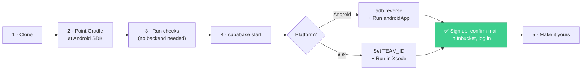
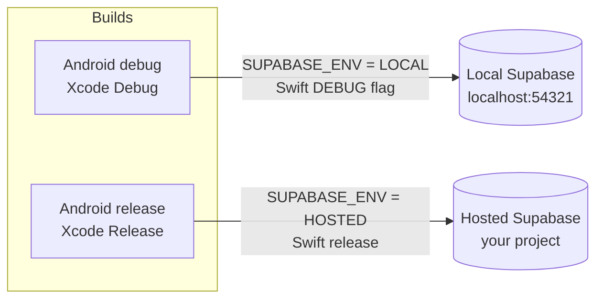
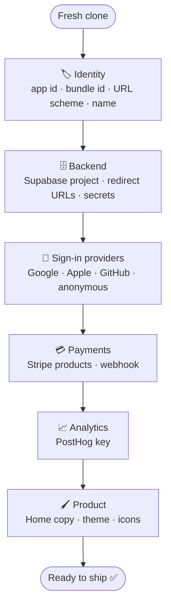
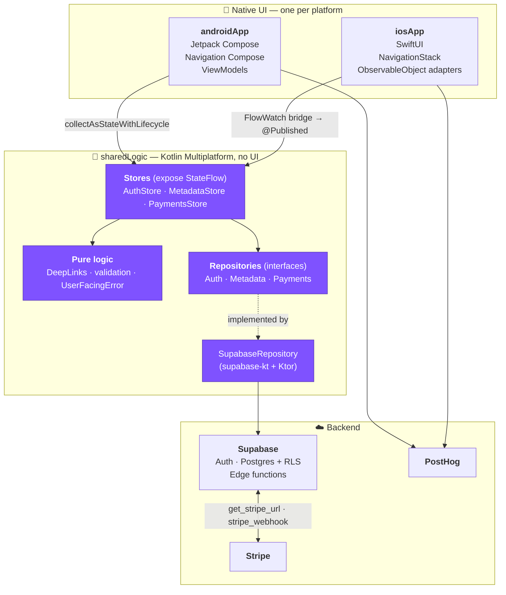
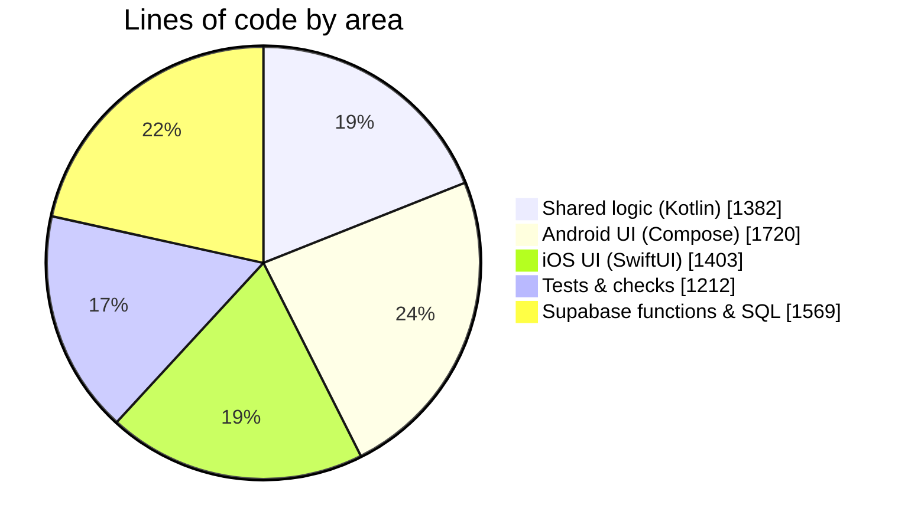
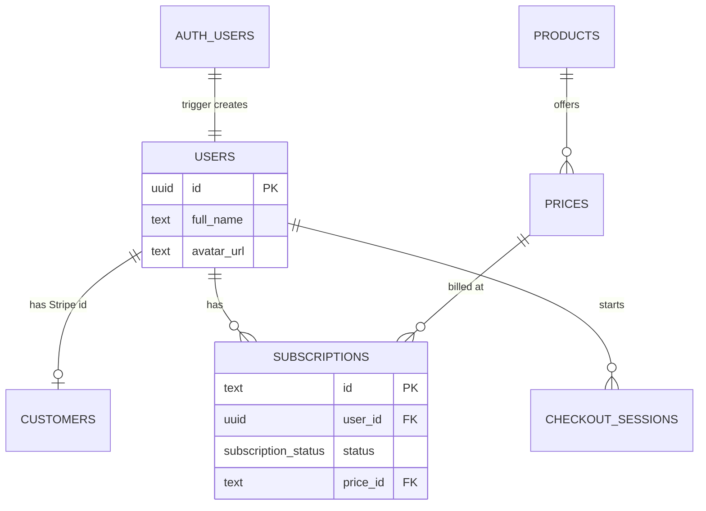
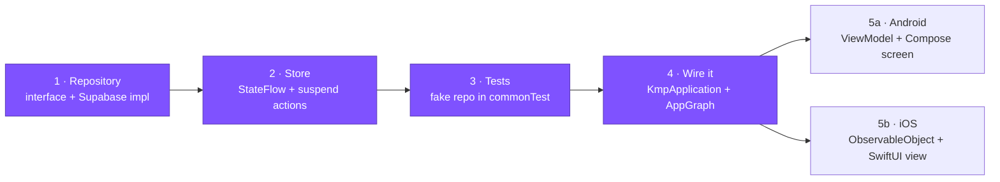
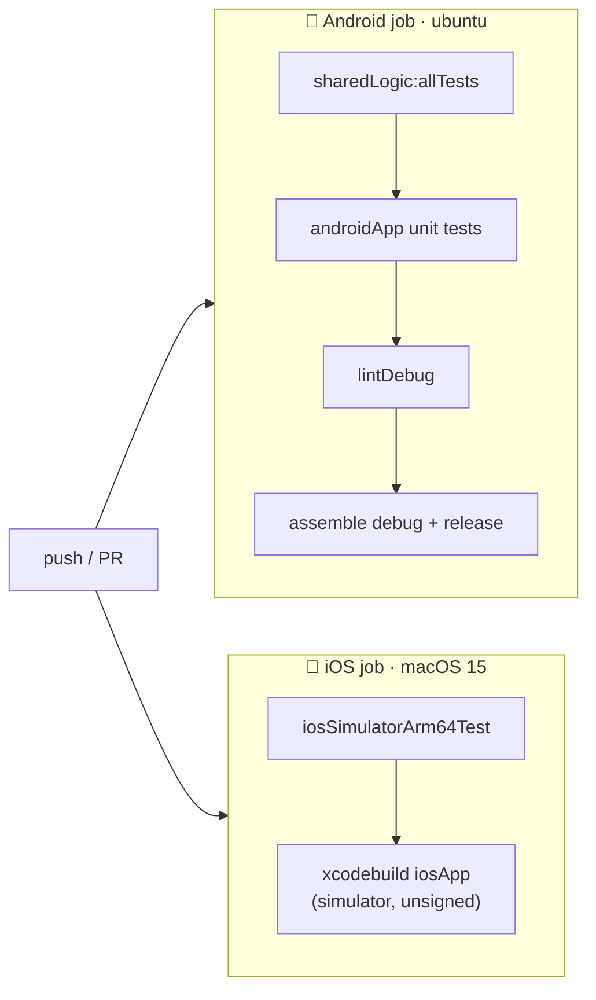

<div align="center">

# 🚀 KMP Startup MVP

### Ship a subscription app on iOS and Android — without writing your business logic twice.

Native UI on both platforms (**Jetpack Compose** + **SwiftUI**) over **one shared
Kotlin Multiplatform core**, wired to **Supabase**, **Stripe** and **PostHog**.

[](https://github.com/mejdi14/kmp-startup-mvp/actions/workflows/ci.yml)


**[Quick start](#-quick-start)** ·
**[Make it yours](#-make-it-yours)** ·
**[Architecture](#-architecture)** ·
**[Add a feature](#-adding-a-feature)** ·
**[Troubleshooting](#-troubleshooting)**

</div>

---

## 📖 Table of contents

1. [What this is](#-what-this-is)
2. [What you get](#-what-you-get)
3. [Quick start](#-quick-start)
4. [Make it yours](#-make-it-yours) — the rename & re-key checklist
5. [Architecture](#-architecture)
6. [Project layout](#-project-layout)
7. [Adding a feature](#-adding-a-feature)
8. [Testing & CI](#-testing--ci)
9. [Before you ship](#-before-you-ship)
10. [Troubleshooting](#-troubleshooting)
11. [Tech stack](#-tech-stack) · [Docs map](#-docs-map)

---

## 💡 What this is

The part of a subscription app that is the same every time — sign-in, session
persistence, an auth gate, guest access, a profile screen, Stripe checkout,
subscription status, analytics, friendly error messages — **already built,
tested and running on both platforms.**

It is deliberately **not** a cross-platform UI framework. Your screens are real
Compose and real SwiftUI, so they look and feel native and you can style them
however you like. **Only the logic underneath is shared.**

> [!NOTE]
> **Where it came from.** This is a port of a Flutter/Next.js boilerplate, kept
> under `flutter/` for reference. `docs/` and `BOILERPLATE-NOTES.md` describe
> that *original* — they are not docs for this template.

---

## ✨ What you get

| | Feature | Details |
|:-:|---|---|
| 🔐 | **Email + password auth** | Sign-up with email confirmation, sign-in, sign-out, password reset by deep link |
| 🪪 | **Social sign-in** | Google (native), Apple (native, iOS), GitHub (browser redirect) |
| 👻 | **Guest mode** | "Continue without login" via a Supabase anonymous session |
| 🔁 | **Guest → real account** | "Save your account" keeps the same user id, data and subscription |
| 🚪 | **Auth-gated navigation** | One derived gate state drives routing; token refreshes never bounce the user |
| 💾 | **Session persistence** | Supabase PKCE sessions survive a cold start on both platforms |
| 💳 | **Stripe subscriptions** | Checkout and Billing Portal via the `get_stripe_url` edge function, with polling on return |
| 📊 | **Subscription status** | `users` row joined with the active subscription, price and product |
| 👤 | **Account screen** | Edit display name and avatar URL, with validation |
| 💬 | **Human error messages** | One shared mapper turns any failure into the same sentence on both platforms |
| 📈 | **Analytics** | PostHog identify/reset tied to the session stream, plus screen views |
| 🔗 | **Deep links** | Custom scheme, shared parsing, for auth returns and Stripe returns — with a "Link didn't work" alert on failure |
| ✅ | **CI from day one** | GitHub Actions: Android tests, lint, assemble; iOS simulator build and Kotlin/Native tests |

**Screens, on both platforms:** Loading · Auth · Home · Account · Payments ·
Recover password · Reset password · Save your account.

---

## ⚡ Quick start

### Prerequisites

| Tool | Why |
|---|---|
| ☕ **JDK 21** | Gradle toolchain (CI uses Temurin 21) |
| 🤖 **Android Studio / Android SDK** | Android app |
| 🍎 **Xcode** (macOS) | iOS app and the Kotlin/Native framework |
| 🐳 **Docker + [Supabase CLI](https://supabase.com/docs/guides/cli)** | Local backend |
| 🦕 **[Deno](https://deno.com)** *(optional)* | Syncing Stripe products into Supabase |

### Your first hour



**1 — Clone**

```bash
git clone https://github.com/mejdi14/kmp-startup-mvp.git my-app
```

**2 — Point Gradle at your Android SDK** *(Android Studio does this for you on first open)*

```bash
echo "sdk.dir=$HOME/Library/Android/sdk" > kmp/local.properties
```

**3 — Run the checks.** No device, no backend, no accounts needed. If this is
green, your toolchain is fine.

```bash
cd kmp && ./gradlew :sharedLogic:allTests :androidApp:testDebugUnitTest :androidApp:lintDebug :androidApp:assembleDebug
```

**4 — Start the local backend**

```bash
supabase start
```

This prints the local API URL and anon key — the debug builds already point at
them, so there's nothing to copy. Sign-up confirmation emails land in
**Inbucket** at <http://localhost:54324>.

**5 — Run the app**

<table>
<tr><th>🤖 Android</th><th>🍎 iOS</th></tr>
<tr valign="top"><td>

1. Open `kmp/` in Android Studio.
2. Forward the backend port (the emulator's `localhost` is itself):
   ```bash
   adb reverse tcp:54321 tcp:54321
   ```
3. Run the **`androidApp`** configuration.

</td><td>

1. Open `kmp/iosApp/iosApp.xcodeproj`.
2. Set `TEAM_ID` in `iosApp/Configuration/Config.xcconfig`.
3. Press **Run**. The *Compile Kotlin Framework* build phase calls Gradle for
   you — no separate step.

</td></tr>
</table>

> [!TIP]
> Want Stripe locally too? Serve the edge functions alongside the database:
> ```bash
> supabase functions serve --env-file supabase/.env.local --import-map supabase/functions/deno.json
> ```
> and fill `supabase/.env.local` with the secrets listed in [SETUP.md § 5](SETUP.md#5-stripe-posthog-loops-backend).

### Which backend does a build talk to?



Both are plain constants in
[`SupabaseConfig.kt`](kmp/sharedLogic/src/commonMain/kotlin/com/mejdi14/kmpstartupmvp/config/SupabaseConfig.kt)
— a URL plus the public **anon** key, committed on purpose. **Nothing secret
lives in the client.** Server secrets (Stripe, Loops, PostHog server key) live
only in git-ignored `supabase/.env*` files.

---

## 🎨 Make it yours

Everything below still points at the original template. Work through it once,
top to bottom, and the app is yours.



### 1. 🏷️ Identity

| What | Current value | Where to change it |
|---|---|---|
| Android application id | `com.mejdi14.kmpstartupmvp` | `kmp/androidApp/build.gradle.kts` (`applicationId`, `namespace`) |
| iOS bundle id | `com.mejdi14.kmpstartupmvp.KmpStartupMvp…` | `kmp/iosApp/Configuration/Config.xcconfig` (`PRODUCT_BUNDLE_IDENTIFIER`) |
| iOS display name | `KmpStartupMvp` | `Config.xcconfig` (`PRODUCT_NAME`) |
| Android app name | `KmpStartupMvp` | `kmp/androidApp/src/main/res/values/strings.xml` |
| **Deep-link scheme** | `com.devtodollars.app` | **All four together:** `DeepLink.kt` (`SCHEME`), `AndroidManifest.xml`, `Info.plist`, `supabase/config.toml` (`additional_redirect_urls`) |
| Kotlin package | `com.mejdi14.kmpstartupmvp` | Optional — Android Studio *Refactor → Rename* on the package |

> [!IMPORTANT]
> The deep-link scheme must match in **all four places** *and* in your hosted
> Supabase dashboard's Redirect URLs, or sign-in, password reset and Stripe
> returns will silently fail to come back to the app.

### 2. 🗄️ Backend

1. Create a Supabase project, then:
   ```bash
   supabase link --project-ref <your-ref>
   supabase db push
   supabase functions deploy --import-map supabase/functions/deno.json
   supabase secrets set --env-file supabase/.env
   ```
2. Put your project URL and anon key into **`SupabaseConfig.HOSTED`**.
3. Dashboard → Authentication → URL Configuration → **Redirect URLs**, add:
   - `<your-scheme>://login-callback`
   - `<your-scheme>://login-callback/**`

### 3. 🔐 Sign-in providers *(all optional)*

| Provider | Supabase | Android | iOS |
|---|---|---|---|
| **Google** | Providers → Google (web client id + secret) | `GOOGLE_WEB_CLIENT_ID` in `~/.gradle/gradle.properties` | `GOOGLE_IOS_CLIENT_ID`, `GOOGLE_WEB_CLIENT_ID`, `GOOGLE_REVERSED_CLIENT_ID` in `Config.xcconfig` |
| **Apple** | Providers → Apple | — | *Sign in with Apple* capability on your App ID |
| **GitHub** | Providers → GitHub (OAuth app) | nothing | nothing |
| **Guest** | Sign In / Providers → **Anonymous sign-ins** (already on locally) | nothing | nothing |

Leave any of them empty and its button shows a clear *"not configured"* error
instead of failing oddly. Don't want guest mode? Delete the button from
`AuthScreen.kt` and `AuthScreen.swift` — nothing else calls `continueAsGuest()`.

### 4. 💳 Payments

1. Add your secrets to `supabase/.env` (hosted) / `supabase/.env.local` (local):
   ```
   STRIPE_SECRET_KEY=
   STRIPE_WEBHOOK_SIGNING_SECRET=
   POSTHOG_CLIENT_KEY=
   LOOPS_API_KEY=
   LOOPS_WELCOME_TEMPLATE_ID=
   ```
2. Sync products and prices: `deno run -A supabase/functions/_scripts/sync-stripe.ts`
3. Point a Stripe webhook at the deployed **`stripe_webhook`** function.

### 5. 📈 Analytics

Replace the PostHog project key in
`kmp/androidApp/src/main/AndroidManifest.xml` and `kmp/iosApp/iosApp/Info.plist`
— otherwise your events land in the template owner's project.

### 6. 🖌️ Product

- The **Home** screen copy and its *"See Pricing"* link are placeholders marked
  `TODO(product-owner)`.
- Colors and typography: `ui/theme/Theme.kt` (Android) and `Theme/AppTheme.swift` (iOS).
- App icons: `androidApp/src/main/res/` and the Xcode asset catalog.

📘 Every step above is explained in depth in **[SETUP.md](SETUP.md)**.

---

## 🏛️ Architecture



### The one rule

> **`sharedLogic` holds business and data logic and never any UI.**

Each platform wraps the *same* stores in its own idiom — an Android `ViewModel`,
an iOS `ObservableObject` fed by a small `StateFlow` bridge — so the state
machine is written once and both apps stay genuinely native.

| Layer | Android | iOS |
|---|---|---|
| **App graph** (owns client + stores) | `KmpApplication.kt` | `AppGraph.kt` (iosMain) + `AppEnvironment.swift` |
| **Adapter** (store → UI state) | `AuthViewModel`, `MetadataViewModel`, `PaymentsViewModel` | `AuthModel`, `MetadataModel`, `PaymentsModel` |
| **Flow bridge** | `collectAsStateWithLifecycle` | `observe` / `observeOptional` in `Bridge.swift` |
| **Navigation** | `AppNavHost.kt` + `Routes.kt` | `RootView.swift` + `Routes.swift` |
| **Screens** | `auth/`, `home/`, `account/`, `payments/` | `Screens/` |

### Where the code lives



Every architectural choice is written down as a numbered decision in
**[PORTING.md](PORTING.md)** (D-001 … D-011) with what was chosen, what was
rejected, and what would make it change.

---

## 🗂️ Project layout

```text
kmp-startup-mvp/
├── kmp/                          ← 👈 the template — you work here
│   ├── sharedLogic/              🧠 Kotlin Multiplatform, logic only
│   │   └── src/
│   │       ├── commonMain/       auth/ · metadata/ · payments/ · errors/ · data/ · config/ · analytics/
│   │       ├── commonTest/       store, validation, deep-link and error-mapping tests
│   │       ├── androidMain/      Android session storage
│   │       └── iosMain/          AppGraph + FlowWatch (the Swift bridge)
│   ├── androidApp/               🤖 Jetpack Compose UI
│   │   └── src/main/kotlin/…/    nav/ · auth/ · home/ · account/ · payments/ · ui/ · analytics/
│   ├── iosApp/                   🍎 SwiftUI UI — open iosApp.xcodeproj
│   │   ├── iosApp/               Adapters/ · Navigation/ · Screens/ · Logic/ · Platform/ · Theme/
│   │   ├── Configuration/        Config.xcconfig (team, bundle id, Google ids)
│   │   └── Checks/               pure-Swift logic checks (run.sh)
│   └── gradle/libs.versions.toml version catalog
├── supabase/                     ☁️ backend
│   ├── migrations/               schema: users · customers · products · prices · subscriptions
│   ├── functions/                get_stripe_url · stripe_webhook · on_user_modify
│   └── config.toml               local config (redirect URLs, anonymous sign-ins)
├── .github/workflows/ci.yml      ✅ CI
├── SETUP.md                      📘 full setup guide
├── PORTING.md                    🧭 design decisions D-001 … D-011
├── TASKS.md                      🧱 how the port was built
└── flutter/ · docs/              📦 original boilerplate — reference only
```

### Database at a glance



All tables have row-level security enabled; Stripe-owned tables are written
only by the `stripe_webhook` function. Details in
[supabase/README.md](supabase/README.md).

---

## 🧩 Adding a feature

The same five steps every time. Shared first, then each platform wraps it.



<details>
<summary><b>Step-by-step walkthrough</b> (click to expand)</summary>

1. **Repository** — in `sharedLogic/src/commonMain/.../<feature>/`, declare an
   interface (`FooRepository`) and implement it in `data/SupabaseRepository.kt`.
2. **Store** — `FooStore(repository, authState, scope)` exposes
   `StateFlow`s and `suspend` actions. Annotate public suspend functions with
   **`@Throws(Throwable::class)`** — without it, a Kotlin exception crashes the
   iOS app instead of reaching Swift as an error.
3. **Tests** — add `FooStoreTest` in `commonTest` with a fake repository (see
   `PaymentsStoreTest` for the pattern). They run on JVM *and* the iOS simulator.
4. **Wire it** — create the store in `KmpApplication.kt` (Android) and
   `ios/AppGraph.kt` (iOS).
5. **UI** —
   - Android: a `FooViewModel` that forwards the store's flows, a Compose screen,
     and a route in `nav/Routes.kt` + `AppNavHost.kt`.
   - iOS: a `FooModel: ObservableObject` that `observe(...)`s the flows into
     `@Published` properties, a SwiftUI view in `Screens/`, and a case in
     `Logic/Routes.swift`.
6. **Errors** — new failure type? Add an `ErrorKind` and its sentence in
   `UserFacingError.kt`; both UIs show it automatically.

</details>

> [!TIP]
> This repo ships Claude Code agents in `.claude/agents/` — e.g. `screen-porter`
> builds one screen on both platforms following these conventions.

---

## ✅ Testing & CI



Run the same thing locally:

```bash
cd kmp
./gradlew :sharedLogic:allTests :androidApp:testDebugUnitTest   # unit tests (JVM)
./gradlew :androidApp:lintDebug                                  # lint
./gradlew :sharedLogic:iosSimulatorArm64Test                     # Kotlin/Native tests (macOS)
iosApp/Checks/run.sh                                             # pure-Swift checks (macOS)
```

| Suite | Covers |
|---|---|
| **86 Kotlin tests** | Stores, auth gate, guest conversion, deep-link parsing, error mapping, validation, routes, Google sign-in config |
| **28 Swift checks** | Email validation, routes, home status, pending-payment logic, nonce |

> [!WARNING]
> **What the tests don't cover.** They are pure-logic tests — no instrumented
> tests, no XCUITests. Real sign-up mail, OAuth round-trips, live Stripe
> checkout and the webhook flipping a subscription to active are unit-tested
> but have **not** been exercised against a live backend. Walk through them
> once your own Supabase and Stripe projects are wired up.

---

## 🚢 Before you ship

- [ ] **Replace `SupabaseConfig.HOSTED`** — release builds currently talk to the original template's backend
- [ ] **Replace the PostHog project key** in `AndroidManifest.xml` and `Info.plist`
- [ ] **Rename the URL scheme** in all four places (+ hosted Redirect URLs)
- [ ] **Rename the application / bundle id**
- [ ] **Add Android release signing** — release is intentionally *unsigned*; add a `signingConfig` fed by your keystore in `androidApp/build.gradle.kts` (never fall back to the debug key)
- [ ] **Fill in Google / Apple / GitHub** client ids you want, remove the ones you don't
- [ ] **Decide on guest mode** — keep it (and plan a cleanup job for abandoned anonymous users) or remove the button
- [ ] **Replace the Home screen placeholder** (`TODO(product-owner)`)
- [ ] **Deploy the edge functions** and register the Stripe webhook
- [ ] **Walk the end-to-end flows** on a real device against your hosted backend
- [ ] **Add a `LICENSE`**

---

## 🛟 Troubleshooting

| Symptom | Cause | Fix |
|---|---|---|
| Network error on Android debug | Emulator `localhost` is the emulator | `adb reverse tcp:54321 tcp:54321` (after every emulator start) |
| Physical iPhone can't reach backend | `localhost` is the phone | Use a hosted project / Release build |
| Login redirect does nothing / "Link didn't work" | Redirect URL not allow-listed, or link expired | Add both `login-callback` URLs ([SETUP § 3](SETUP.md#3-allow-the-mobile-redirect-url-required-for-auth)); request a new link |
| Sign-up says "check your email" | Email confirmation is on (by design) | Open the mail in Inbucket: <http://localhost:54324> |
| "Anonymous sign-ins are disabled" | Provider off on hosted project | Dashboard → Sign In / Providers → Anonymous sign-ins |
| Google button says "not configured" | Client ids empty | Fill them in (see [Make it yours § 3](#3--sign-in-providers-all-optional)) |
| Guest can't subscribe | Intentional — no email for Stripe | "Save your account" first |
| Subscription doesn't update after paying | Webhook not deployed / not receiving events | Deploy `stripe_webhook`, check Stripe's webhook log |
| iOS app crashes on a failed call | Missing `@Throws` on a shared `suspend fun` | Add `@Throws(Throwable::class)` |

---

## 🧰 Tech stack

| | |
|---|---|
| **Language** | Kotlin 2.4.20 · Swift |
| **Shared** | kotlinx-coroutines 1.10 · kotlinx-serialization · multiplatform-settings |
| **Android** | Jetpack Compose (BOM 2026.09.00) · Material 3 · Navigation Compose · Credential Manager · Custom Tabs |
| **iOS** | SwiftUI · `NavigationStack` · `ASWebAuthenticationSession` · AuthenticationServices · GoogleSignIn |
| **Backend** | Supabase (`supabase-kt` 3.8.0: auth + postgrest + functions) · Ktor 3.5.2 · Deno edge functions |
| **Payments** | Stripe Checkout + Billing Portal (hosted pages) |
| **Analytics** | PostHog (native SDK per platform) |
| **Build** | Gradle · AGP 9.1.1 · version catalog · GitHub Actions |

---

## 📚 Docs map

| Document | Read it when you want to… |
|---|---|
| **[SETUP.md](SETUP.md)** | Go from clone to a running app, in depth: backends, redirect URLs, providers, guests, Stripe, signing |
| **[PORTING.md](PORTING.md)** | Understand *why* — numbered decisions D-001 … D-011 |
| [TASKS.md](TASKS.md) | See the build order the port was assembled in |
| [kmp/README.md](kmp/README.md) | Grab the Gradle / xcodebuild one-liners |
| [supabase/README.md](supabase/README.md) | Work on the schema and edge functions |

<div align="center">

---

Built with Kotlin Multiplatform · Made to be forked 🍴

</div>
