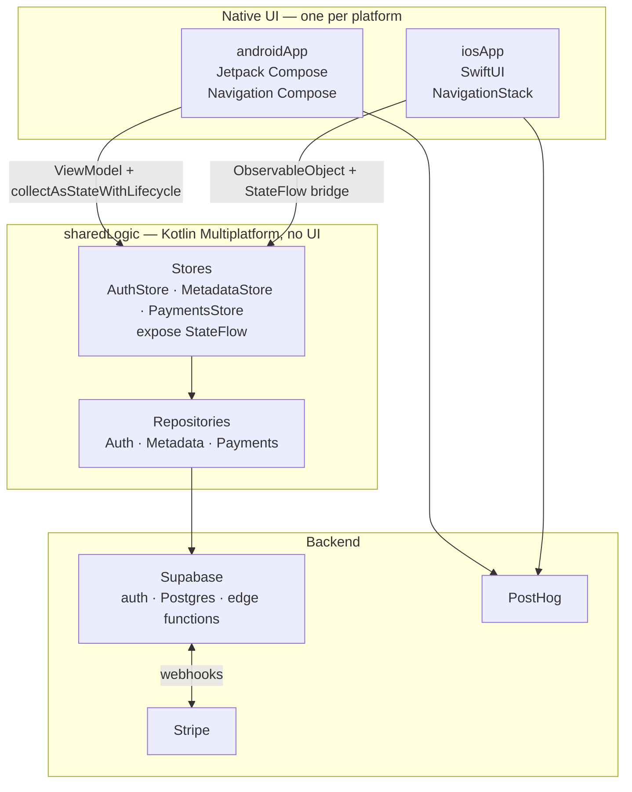

<div align="center">

# KMP Startup MVP

**Ship a subscription app on iOS and Android without writing your business logic twice.**

Native UI on both platforms — Jetpack Compose and SwiftUI — over one shared
Kotlin Multiplatform core, wired to Supabase, Stripe and PostHog.

[](https://github.com/mejdi14/kmp-startup-mvp/actions/workflows/ci.yml)


</div>

---

## What this is

The part of a subscription app that is the same every time — sign-in, session
persistence, an auth gate, a profile screen, Stripe checkout, subscription
status, analytics — already built, tested and running on both platforms.

It is deliberately **not** a cross-platform UI framework. Your screens are real
Compose and real SwiftUI, so they look and feel native and you can style them
however you like. Only the logic underneath is shared.

> **Where it came from.** This is a port of a Flutter/Next.js boilerplate, kept
> under `flutter/` for reference. `docs/` and `BOILERPLATE-NOTES.md` describe
> that *original* — they are not docs for this template.

## What you get

| | Feature | Details |
|---|---|---|
| 🔐 | **Email + password auth** | Sign-up with email confirmation, sign-in, sign-out, password reset by deep link |
| 🪪 | **Social sign-in** | Google (native, Credential Manager / GoogleSignIn), Apple (native), GitHub (browser redirect) |
| 🚪 | **Auth-gated navigation** | One derived gate state drives routing; token refreshes never bounce the user |
| 💾 | **Session persistence** | Supabase PKCE sessions survive a cold start on both platforms |
| 💳 | **Stripe subscriptions** | Checkout and Billing Portal via the `get_stripe_url` edge function, with polling on return |
| 📊 | **Subscription status** | `users` row joined with the active subscription, price and product |
| 👤 | **Account screen** | Edit display name and avatar URL, with validation |
| 📈 | **Analytics** | PostHog identify/reset tied to the session stream, plus screen views |
| 🔗 | **Deep links** | Custom scheme, shared parsing, used for auth returns and Stripe returns |
| ✅ | **CI from day one** | GitHub Actions: Android tests, lint, assemble; iOS simulator build and Kotlin/Native tests |

Screens, on both platforms: **Loading** · **Auth** · **Home** · **Account** ·
**Payments** · password **recover** and **reset** sheets.

## How it fits together



**The one rule:** `sharedLogic` holds business and data logic and never any UI.
Each platform wraps the same stores in its own idiom — an Android `ViewModel`,
an iOS `ObservableObject` over a `StateFlow` bridge — so the state machine is
written once and both apps stay genuinely native.

The reasoning behind every such choice is written down in
**[PORTING.md](PORTING.md)** as numbered decisions (D-001 … D-008).

## Project layout

| Path | Contents |
|---|---|
| **`kmp/sharedLogic`** | Shared logic only: Supabase client, repositories, stores, validation, deep links |
| **`kmp/androidApp`** | Jetpack Compose UI, Navigation Compose, Google sign-in, Custom Tabs |
| **`kmp/iosApp`** | SwiftUI UI, `NavigationStack`, Apple/Google sign-in — open `iosApp.xcodeproj` |
| `supabase/` | Migrations, edge functions (`get_stripe_url`, `stripe_webhook`, `on_user_modify`), local config |
| `.github/workflows/ci.yml` | The CI that runs on every push and PR |
| **[`SETUP.md`](SETUP.md)** | Full setup: backends, redirect URLs, social sign-in, Stripe, signing |
| [`PORTING.md`](PORTING.md) · [`TASKS.md`](TASKS.md) | Design decisions and the build order of the port |
| `flutter/` · `docs/` | The original Flutter/Next.js boilerplate — **reference only** |

## Quick start

**Prerequisites:** JDK 21 · Android SDK · Xcode (for iOS) · Docker + the
[Supabase CLI](https://supabase.com/docs/guides/cli) (for the local backend).

**1. Point Gradle at your Android SDK**

```sh
echo "sdk.dir=$HOME/Library/Android/sdk" > kmp/local.properties
```

**2. Run the checks — no device, no backend, no accounts needed**

```sh
cd kmp && ./gradlew :sharedLogic:allTests :androidApp:testDebugUnitTest :androidApp:lintDebug :androidApp:assembleDebug
```

**3. Start the local backend and run the app**

```sh
supabase start
```

- **Android:** open `kmp/` in Android Studio, run `androidApp`.
  On an emulator, `localhost` is the emulator itself — run
  `adb reverse tcp:54321 tcp:54321` first.
- **iOS:** open `kmp/iosApp/iosApp.xcodeproj`, set `TEAM_ID` in
  `iosApp/Configuration/Config.xcconfig`, and run. The *Compile Kotlin
  Framework* build phase calls Gradle for you.

One more step is **required** before auth redirects work: allow-list the
redirect URL as described in [SETUP.md § 3](SETUP.md#3-allow-the-mobile-redirect-url-required-for-auth). Then follow the rest of
SETUP.md for social sign-in and Stripe.

### Which backend a build talks to

| Build | Backend |
|---|---|
| Android **debug** / Xcode **Debug** | Local Supabase, `http://localhost:54321` |
| Android **release** / Xcode **Release** | Hosted Supabase |

Both are plain constants in `SupabaseConfig.kt` — URL plus the public **anon**
key, committed on purpose, mirroring Flutter's `env.local.json` / `env.json`
split. Nothing secret lives in the client.

## Status

Every check below was run on the current `main`:

| Check | Result |
|---|---|
| `:sharedLogic:allTests` (common, Android host, iOS simulator) | ✅ passing |
| `:androidApp:testDebugUnitTest` · `:lintDebug` · `:assembleDebug` | ✅ passing |
| `xcodebuild` iosApp, Debug, iOS Simulator | ✅ building |
| `iosApp/Checks/run.sh` — 19 pure-Swift logic checks | ✅ passing |
| GitHub Actions CI (Android + iOS jobs) | ✅ green |

That is **64 Kotlin test functions plus 19 Swift checks**, covering the stores,
validation, route mapping and deep-link parsing.

**What those tests do not cover.** They are pure-logic tests. There are no
instrumented tests and no XCUITests, so the end-to-end flows — real sign-up
mail, OAuth round-trips, live Stripe checkout and the webhook that flips a
subscription to active — compile and are unit-tested but have not been
observed running against a live backend. Walk through them yourself once you
have your own Supabase and Stripe projects wired up.

## Before you ship

This is a template, so a few things still point at the original project. Each
one is a deliberate, documented placeholder:

- [ ] **Replace `SupabaseConfig.HOSTED`** — it currently points at the original
      template's Supabase project, so *release* builds talk to someone else's
      backend.
- [ ] **Replace the PostHog project key** in `androidApp/src/main/AndroidManifest.xml`
      and `iosApp/iosApp/Info.plist` — otherwise your analytics land in the
      template owner's project.
- [ ] **Rename the URL scheme** `com.devtodollars.app` to your own, in
      `AndroidManifest.xml`, `Info.plist` and `DeepLink.kt`.
- [ ] **Rename the application / bundle ID** from `com.mejdi14.kmpstartupmvp`.
- [ ] **Add release signing** — the Android release build is intentionally
      *unsigned*; it must not fall back to the debug key. Add a `signingConfig`
      fed by your keystore in `androidApp/build.gradle.kts`.
- [ ] **Fill in the Google / Apple / GitHub client IDs** you want. Left empty,
      those buttons show a clear "not configured" error instead of failing oddly.
- [ ] **Replace the Home screen placeholder** — its copy and its "See Pricing"
      link are carried over from the original and marked `TODO(product-owner)`.
- [ ] **Add a `LICENSE`** — the repository does not have one yet.

## Tech stack

| | |
|---|---|
| **Language** | Kotlin 2.4.20 · Swift |
| **Shared** | kotlinx-coroutines · kotlinx-serialization · multiplatform-settings |
| **Android** | Jetpack Compose (BOM 2026.09.00) · Material 3 · Navigation Compose · Credential Manager · Custom Tabs |
| **iOS** | SwiftUI · `NavigationStack` · `ASWebAuthenticationSession` · AuthenticationServices |
| **Backend** | Supabase (`supabase-kt` 3.8.0, auth + postgrest + functions) · Ktor 3.5.2 |
| **Payments** | Stripe, via Supabase edge functions |
| **Analytics** | PostHog (native SDK per platform) |
| **Build** | Gradle · AGP 9.1.1 · version catalog · GitHub Actions |

## Docs

| Document | Read it for |
|---|---|
| **[SETUP.md](SETUP.md)** | Going from clone to a running app: backends, redirect URLs, social sign-in, Stripe secrets, signing, troubleshooting |
| [PORTING.md](PORTING.md) | Why the architecture is the way it is — numbered decisions D-001 … D-008 |
| [TASKS.md](TASKS.md) | The 15 build tasks the port was assembled from, in dependency order |
| [supabase/README.md](supabase/README.md) | The database schema and edge functions |
